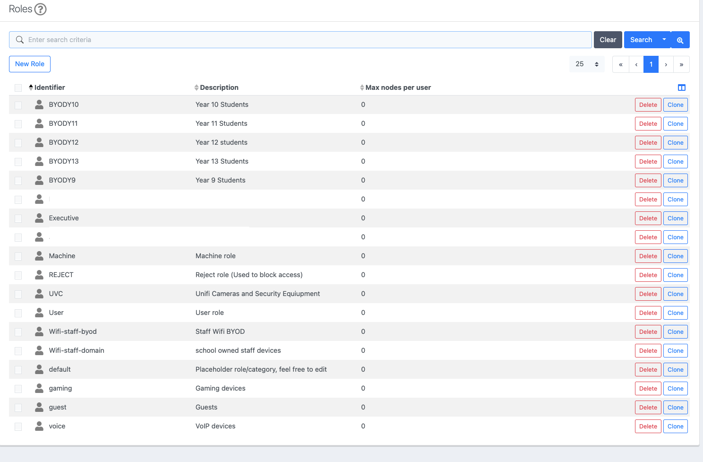
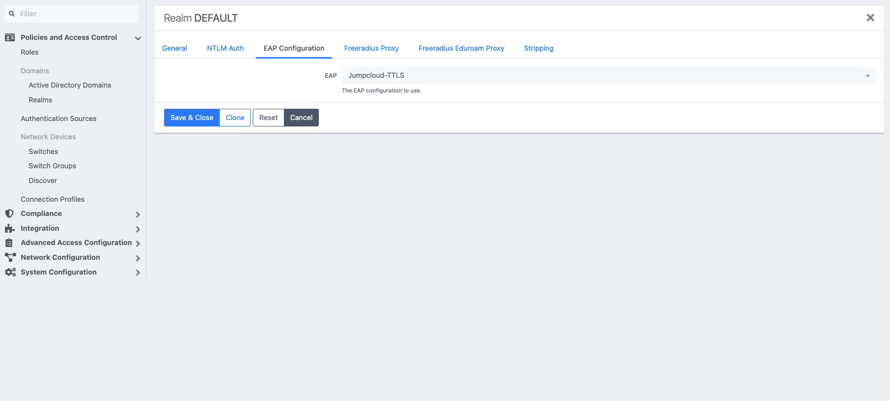
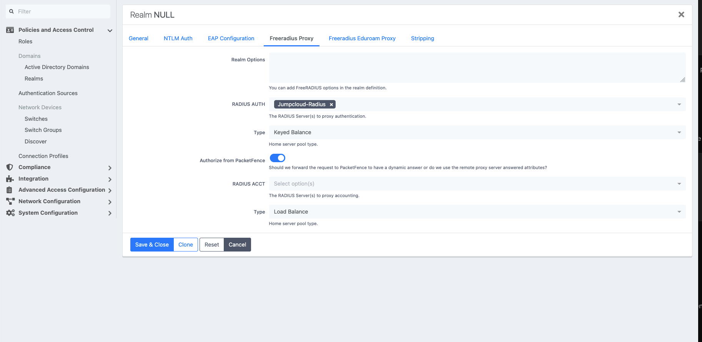
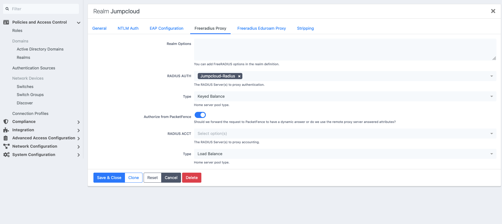
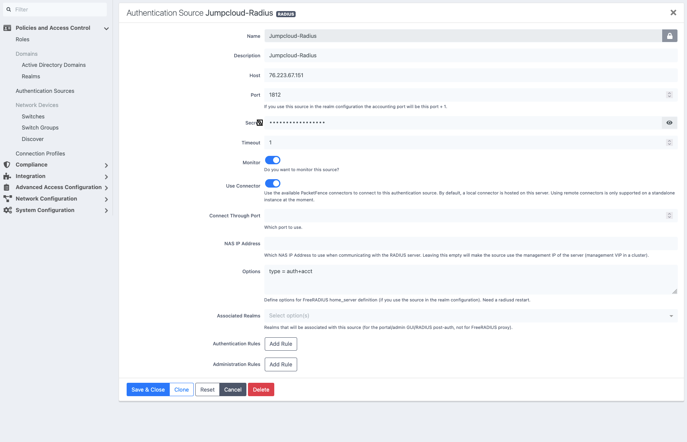
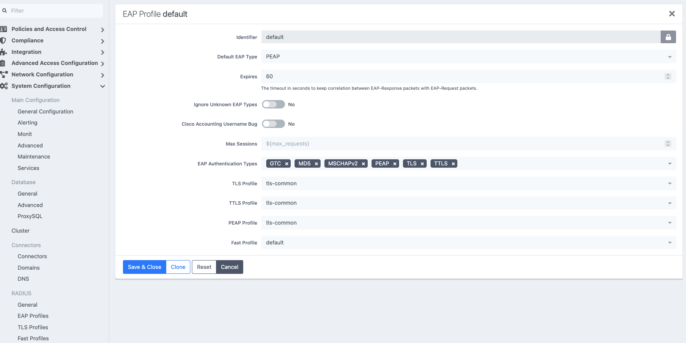
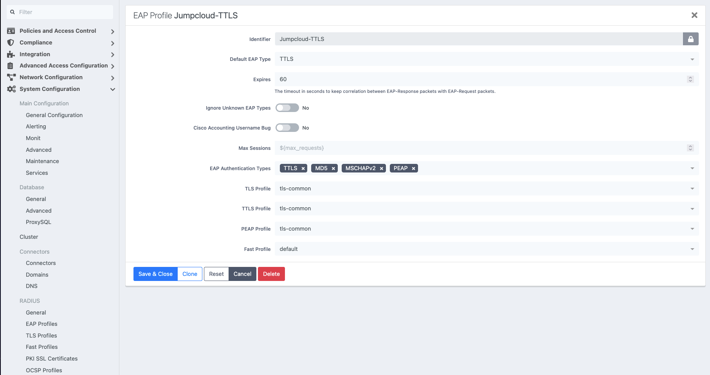
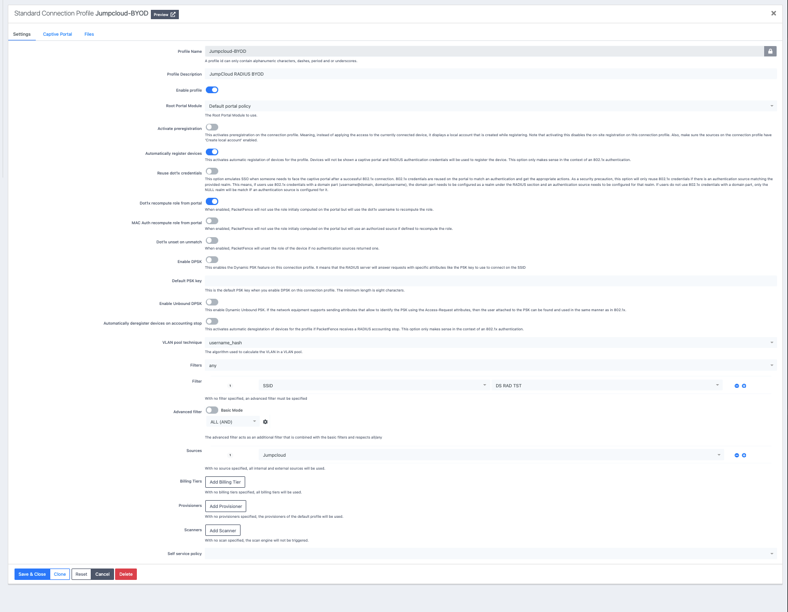
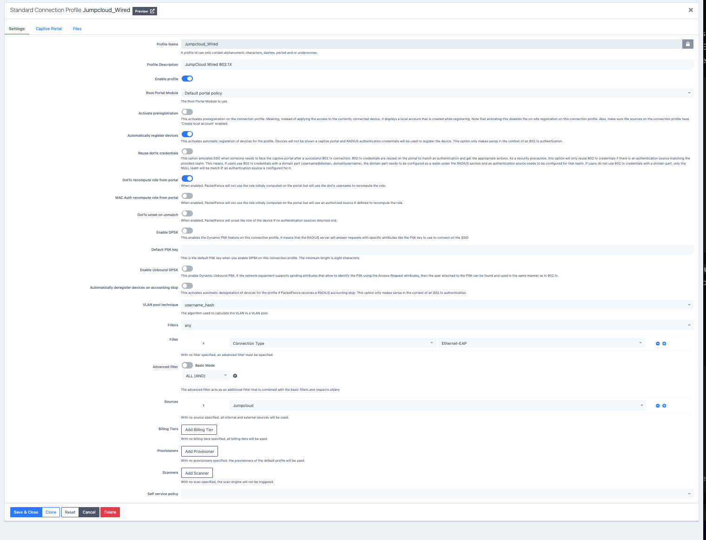

# PacketFence 15 Configuration Guide

This is the PacketFence build path for the tested UniFi + JumpCloud design. It records what was configured (**Tested**). For why, see [Design Decisions](../architecture/design-decisions.md); for the end-to-end picture, see the [Architecture Overview](../architecture/overview.md).

> **Public documentation notice**
>
> All IP addresses, VLAN IDs, usernames, MAC addresses, directory identifiers, group names and organisational role names shown here are examples or placeholders. Do not publish RADIUS shared secrets, LDAP bind credentials, API tokens or production directory identifiers. Some screenshots show less-sanitised values than the text; see [Security Model](../security/security-model.md#documentation-hygiene).

Build order:

1. [General settings](#3-general-settings) (timezone)
2. [Roles](#4-roles)
3. [Realms](#5-realms)
4. [JumpCloud RADIUS source](#6-jumpcloud-radius-authentication-source) and [LDAP source](#7-jumpcloud-ldap-authentication-source)
5. [LDAP rules](#8-ldap-authentication-rules)
6. [EAP profiles](#9-eap-profiles)
7. [Connection profiles](#10-connection-profiles)
8. [Network devices](network-devices.md) (UniFi as NAS)
9. [MAB](mab.md)
10. [UniFi side](../unifi/configuration.md)
11. [Validate](../operations/validation-checklist.md)

Role separation, in one line each:

```text
JumpCloud RADIUS -> validate credentials
JumpCloud LDAP   -> expose user/group membership
PacketFence      -> evaluate rules, assign roles and VLANs, enforce policy
```

---

# 3. General Settings

## Timezone

Set PacketFence to the correct IANA timezone.

Example:

```ini
timezone=Pacific/Auckland
```

Check the effective setting:

```bash
grep -n '^timezone' /usr/local/pf/conf/pf.conf
```

Also confirm the Linux host:

```bash
timedatectl
date
```

Use a named timezone rather than a fixed offset so daylight-saving changes are handled correctly.

---

# 4. Roles



Navigate to:

```text
Configuration
  -> Policies and Access Control
  -> Roles
```

PacketFence roles represent the policy outcome for a user or device.

> **Screenshot vs text.** The screenshot is the real role list and uses different identifiers from the generic examples below (for example `BYODY9`..`BYODY13`, `Wifi-staff-byod`, `Wifi-staff-domain`, `Executive`, `User`, `gaming`, `guest`, `voice`). The one role that is identical in both is **`UVC`** ("Unifi Cameras and Security Equipment"), which is the tested MAB role. The table below uses generic names for the user roles.

Typical public examples:

| Identifier | Description | Purpose |
| --- | --- | --- |
| `Staff` | Staff users | General staff access |
| `Privileged-Staff` | Privileged staff | Higher-trust access |
| `Students-9` | Year 9 students | Student cohort access |
| `Students-10` | Year 10 students | Student cohort access |
| `Students-11` | Year 11 students | Student cohort access |
| `Students-12` | Year 12 students | Student cohort access |
| `Students-13` | Year 13 students | Student cohort access |
| `UVC` | UniFi cameras and security equipment | Local MAB devices |
| `Machine` | Generic machine role | Device access |
| `REJECT` | Reject role | Explicit deny |
| `Guest` | Guest users | Guest access |
| `Voice` | VoIP devices | Voice access |

The tested roles use:

```text
Max nodes per user = 0
```

Role design principles:

1. Create distinct roles for materially different access policies.
2. Keep user roles separate from MAB/device roles.
3. Put privileged populations in explicit roles.
4. Avoid relying on `default` as a catch-all.
5. Remove temporary test roles before production.
6. Keep role-to-VLAN mappings simple and predictable.

---

# 5. Realms

Navigate to:

```text
Configuration
  -> Policies and Access Control
  -> Domains
  -> Realms
```

The tested design uses three relevant realms:

- `DEFAULT`
- `NULL`
- `Jumpcloud`

## DEFAULT Realm



Under:

```text
Realm DEFAULT
  -> EAP Configuration
```

configure:

| Setting | Value |
| --- | --- |
| EAP | `Jumpcloud-TTLS` |

This selects the dedicated JumpCloud EAP profile for the default EAP processing path.

## NULL Realm



Under:

```text
Realm NULL
  -> Freeradius Proxy
```

configure:

| Setting | Value |
| --- | --- |
| RADIUS AUTH | `Jumpcloud-Radius` |
| Type | `Keyed Balance` |
| Authorize from PacketFence | Enabled |
| RADIUS ACCT | Not configured |
| Accounting Type | `Load Balance` |

Normal usernames without an explicit realm suffix use the NULL realm.

The important settings are:

```text
RADIUS AUTH = Jumpcloud-Radius
Authorize from PacketFence = Enabled
```

This means JumpCloud validates credentials, while PacketFence still makes the final authorization decision.

## Jumpcloud Realm



Under:

```text
Realm Jumpcloud
  -> Freeradius Proxy
```

configure:

| Setting | Value |
| --- | --- |
| RADIUS AUTH | `Jumpcloud-Radius` |
| Type | `Keyed Balance` |
| Authorize from PacketFence | Enabled |
| RADIUS ACCT | Not configured |
| Accounting Type | `Load Balance` |

The tested design therefore maps both realms to the same upstream RADIUS source:

```text
NULL      -> Jumpcloud-Radius
Jumpcloud -> Jumpcloud-Radius
```

with local PacketFence authorization enabled.

## Why "Authorize from PacketFence" is enabled

Conceptually:

```text
JumpCloud:
"Are these credentials valid?"

PacketFence:
"What network access should this identity receive?"
```

PacketFence must remain responsible for role and VLAN assignment.

## Do not alter NULL realm globally for MAB

The NULL realm is part of the known-good PEAP authentication path.

MAB should instead be redirected selectively with:

```text
control:Proxy-To-Realm = local
request:Realm = local
```

---

# 6. JumpCloud RADIUS Authentication Source



Navigate to:

```text
Configuration
  -> Policies and Access Control
  -> Authentication Sources
```

Create a RADIUS source named:

```text
Jumpcloud-Radius
```

Example public configuration:

| Setting | Value |
| --- | --- |
| Name | `Jumpcloud-Radius` |
| Description | `Jumpcloud-Radius` |
| Host | `<JUMPCLOUD_RADIUS_HOST>` |
| Port | `1812` |
| Secret | `<RADIUS_SHARED_SECRET>` |
| Timeout | `1` |
| Monitor | Enabled |
| Use Connector | Enabled |
| Connect Through Port | Not set |
| NAS IP Address | Not set |
| Options | `type = auth+acct` |
| Associated Realms | Not required here |
| Authentication Rules | None |
| Administration Rules | None |

The source is referenced by the realms under `RADIUS AUTH`.

The tested source uses:

```text
UDP/1812
```

and the home-server option:

```text
type = auth+acct
```

The RADIUS source itself does not contain PacketFence authorization rules. Those live on the LDAP source.

---

# 7. JumpCloud LDAP Authentication Source

Navigate to:

```text
Configuration
  -> Policies and Access Control
  -> Authentication Sources
```

Create an LDAP source named:

```text
Jumpcloud
```

Example public configuration:

| Setting | Value |
| --- | --- |
| Name | `Jumpcloud` |
| Description | `Jumpcloud` |
| Host | `<JUMPCLOUD_LDAP_HOST>` |
| Port | `636` |
| Encryption | `SSL` |
| SSL Verify Mode | `none` |
| Dead duration | `60` |
| Connection timeout | `1` |
| Request timeout | `5` |
| Response timeout | `10` |
| Scope | `Subtree` |
| Username Attribute | `uid` |
| Email Attribute | `mail` |
| Cache match | Enabled |
| Monitor | Enabled |
| Shuffle | Disabled |
| Use Connector | Enabled |

## Base DN

Example:

```text
ou=Users,o=<JUMPCLOUD_ORG_ID>,dc=jumpcloud,dc=com
```

## Bind DN

Example:

```text
uid=<LDAP_BIND_USER>,ou=Users,o=<JUMPCLOUD_ORG_ID>,dc=jumpcloud,dc=com
```

The password must remain private.

## SSL verification

The tested configuration uses:

```text
SSL Verify Mode = none
```

For production, certificate verification should be enabled where possible and the required CA chain trusted.

## Connector use

The tested source has:

```text
Use Connector = Enabled
```

In containerised PacketFence deployments, validate DNS and LDAP reachability from the PacketFence service/connector context, not just from the Linux host.

Useful checks:

```bash
dig ldap.jumpcloud.com
getent hosts ldap.jumpcloud.com
```

---

# 8. LDAP Authentication Rules

The JumpCloud LDAP source contains rules that map directory group membership to PacketFence roles.

The tested rules cover categories such as:

- privileged users
- staff BYOD
- student year groups
- general Wi-Fi users

A representative rule uses:

```text
LDAP attribute: memberOf
Operator:       equals
Value:          cn=Staff,ou=Users,o=<JUMPCLOUD_ORG_ID>,dc=jumpcloud,dc=com
```

and applies:

```text
Role = Staff
```

A rule may also set an access duration.

One tested rule used:

```text
Access duration = 5 days
```

## Rule matching

The tested rules use:

```text
Matches = All
```

so all conditions in a rule must match.

## Rule ordering

More specific rules should be above broad rules.

Example:

```text
1. Privileged Staff
2. Specialist Staff
3. Student cohorts
4. Staff BYOD
5. General Wi-Fi Users
```

This prevents a broad group from matching before a more specific group can assign the correct role.

---

# 9. EAP Profiles

Navigate to:

```text
Configuration
  -> System Configuration
  -> RADIUS
  -> EAP Profiles
```

Two relevant profiles exist:

- `default`
- `Jumpcloud-TTLS`

## default EAP Profile



| Setting | Value |
| --- | --- |
| Identifier | `default` |
| Default EAP Type | `PEAP` |
| Expires | `60` |
| Ignore Unknown EAP Types | `No` |
| Cisco Accounting Username Bug | `No` |
| Max Sessions | `${max_requests}` |
| EAP Authentication Types | `GTC`, `MD5`, `MSCHAPv2`, `PEAP`, `TLS`, `TTLS` |
| TLS Profile | `tls-common` |
| TTLS Profile | `tls-common` |
| PEAP Profile | `tls-common` |
| Fast Profile | `default` |

## Jumpcloud-TTLS EAP Profile



| Setting | Value |
| --- | --- |
| Identifier | `Jumpcloud-TTLS` |
| Default EAP Type | `TTLS` |
| Expires | `60` |
| Ignore Unknown EAP Types | `No` |
| Cisco Accounting Username Bug | `No` |
| Max Sessions | `${max_requests}` |
| EAP Authentication Types | `TTLS`, `MD5`, `MSCHAPv2`, `PEAP` |
| TLS Profile | `tls-common` |
| TTLS Profile | `tls-common` |
| PEAP Profile | `tls-common` |
| Fast Profile | `default` |

The `DEFAULT` realm is explicitly configured to use `Jumpcloud-TTLS`.

The dedicated profile is narrower than the built-in default profile and makes TTLS the default EAP method.

> **`Jumpcloud-TTLS` is a profile name and default, not a statement of the client method.** The profile's *Default EAP Type* is `TTLS`, but it also enables `MSCHAPv2` and `PEAP`, and the tested wireless and wired clients authenticated with **PEAP/MSCHAPv2**. See [Design Decision D8](../architecture/design-decisions.md#d8-jumpcloud-ttls-is-a-profile-name-and-default-not-a-client-mandate). Whether any tested client negotiated TTLS is not recorded (`needs validation`).

## Operational guidance

- Keep `Jumpcloud-TTLS` associated with the `DEFAULT` realm.
- Do not remove `MSCHAPv2` or `PEAP` while clients still depend on them.
- `MD5` is enabled in both profiles as tested. Whether it is required is unproven; see [Security Model](../security/security-model.md#eap-md5-is-enabled).
- Changes to `tls-common` can affect PEAP, TTLS and TLS authentication.

---

# 10. Connection Profiles

Navigate to:

```text
Configuration
  -> Policies and Access Control
  -> Connection Profiles
```

The tested design separates wireless BYOD and wired 802.1X.

Both profiles use the same JumpCloud LDAP authentication source.

## Wireless BYOD Profile



Example:

| Setting | Value |
| --- | --- |
| Profile Name | `Jumpcloud-BYOD` |
| Profile Description | `JumpCloud RADIUS BYOD` |
| Enable profile | Enabled |
| Root Portal Module | `Default portal policy` |
| Activate preregistration | Disabled |
| Automatically register devices | Enabled |
| Reuse dot1x credentials | Disabled |
| Dot1x recompute role from portal | Enabled |
| MAC Auth recompute role from portal | Disabled |
| Dot1x unset on unmatch | Disabled |
| Enable DPSK | Disabled |
| Enable Unbound DPSK | Disabled |
| Automatically deregister devices on accounting stop | Disabled |
| VLAN pool technique | `username_hash` |
| Filters | `any` |
| Authentication Source | `Jumpcloud` |

Wireless profile filter:

```text
SSID = <WIRELESS_SSID>
```

Public example:

```text
SSID = CORP-BYOD
```

## Wired 802.1X Profile



Example:

| Setting | Value |
| --- | --- |
| Profile Name | `Jumpcloud_Wired` |
| Profile Description | `JumpCloud Wired 802.1X` |
| Enable profile | Enabled |
| Root Portal Module | `Default portal policy` |
| Activate preregistration | Disabled |
| Automatically register devices | Enabled |
| Reuse dot1x credentials | Disabled |
| Dot1x recompute role from portal | Enabled |
| MAC Auth recompute role from portal | Disabled |
| Dot1x unset on unmatch | Disabled |
| Enable DPSK | Disabled |
| Enable Unbound DPSK | Disabled |
| Automatically deregister devices on accounting stop | Disabled |
| VLAN pool technique | `username_hash` |
| Filters | `any` |
| Authentication Source | `Jumpcloud` |

Wired profile filter:

```text
Connection Type = Ethernet-EAP
```

This is intentionally different from the problematic RADIUS authorize-stage condition `Ethernet-NoEAP`.

## Why separate wired and wireless profiles

Separate profiles make it easier to:

- match access methods independently
- troubleshoot profile selection
- change wired or wireless policy independently
- add future access-method-specific behaviour

---

# 11. Normal 802.1X Flow

The final user flow is:

```text
Client
  |
  | PEAP / TTLS / MSCHAPv2
  v
UniFi
  |
  v
PacketFence connection profile
  |
  v
DEFAULT EAP processing
  |
  v
Jumpcloud-TTLS
  |
  v
NULL / Jumpcloud realm
  |
  v
Jumpcloud-Radius
  |
  v
JumpCloud RADIUS
  |
  | Access-Accept
  v
PacketFence
  |
  v
JumpCloud LDAP source
  |
  v
memberOf rule
  |
  v
PacketFence role
  |
  v
Dynamic VLAN
```

A typical final response includes:

```text
Tunnel-Type = VLAN
Tunnel-Medium-Type = IEEE-802
Tunnel-Private-Group-Id = "<VLAN ID>"
```

---

# 12. MAC Authentication Bypass

MAB (category `UVC`, the `Unifi-MAC-Auth-Local` RADIUS filter, rejected approaches) is documented in [MAB](mab.md). The filter screenshot `radius-filter.png` is shown there.

---

# 13. Dynamic VLAN Requirements

PacketFence returns standard RADIUS tunnel attributes:

```text
Tunnel-Type = VLAN
Tunnel-Medium-Type = IEEE-802
Tunnel-Private-Group-Id = "<VLAN ID>"
```

Every VLAN PacketFence can return must:

- exist on the network
- be allowed across required trunks
- reach the AP or access switch
- have working DHCP
- have the correct gateway/firewall policy

A correct PacketFence Access-Accept cannot compensate for a missing VLAN on the switching path.

---

# 14. RADIUS Accounting

UniFi sends accounting directly to PacketFence on:

```text
UDP/1813
```

The realm configuration does not need to proxy accounting upstream in the documented design.

Use PacketFence accounting and RADIUS audit data to correlate session state and authentication results.

---

# 15. Known Issue: RADIUS Audit Timestamp

PacketFence 15 shows RADIUS Audit entries at the wrong local time (+13 hours with `Pacific/Auckland` during NZDT) because the API marks a local timestamp as UTC. The build works without the workaround; it only affects how audit times are displayed, but it matters when correlating logs. Details, evidence and the local workaround are in [Known Issues: RADIUS audit timestamp](../known-issues/radius-audit-timestamp.md). Do not "fix" it by changing the server or PacketFence timezone.

---

# 16. Service Checks and Troubleshooting

Commands and the stage-by-stage method are in [Troubleshooting](../operations/troubleshooting.md). The post-build test list is the [Validation Checklist](../operations/validation-checklist.md).

---

# 17. Known-Good Design Rules

The final implementation follows these principles:

1. UniFi sends RADIUS to PacketFence.
2. PacketFence proxies normal user authentication to JumpCloud RADIUS.
3. JumpCloud LDAP supplies group information for PacketFence policy.
4. The NULL realm remains part of the working user authentication path.
5. PacketFence remains responsible for authorization and VLAN assignment.
6. Wired and wireless access use separate connection profiles.
7. Registered MAB devices are identified using `node_info.category`.
8. MAB overrides both `Proxy-To-Realm` and `Realm` to `local`.
9. Unknown MAB endpoints are not automatically trusted (design intent; the observed outcome is `needs validation`, see the [Authentication Matrix](../architecture/authentication-matrix.md#unknown-and-unregistered-mac-behaviour)).
10. Authentication rules are ordered from most specific to least specific.
11. Dynamic VLANs are validated end-to-end across the network.
12. Site-specific source-code workarounds should be replaced by upstream fixes where possible.

---

## Security

Hardening items for this configuration (`SSL Verify Mode = none`, EAP-MD5, MAB trust boundary) are in the [Security Model](../security/security-model.md). They are documented, not changed here.

---

## Related Documentation

- [Network Devices](network-devices.md)
- [MAB](mab.md)
- [UniFi configuration](../unifi/configuration.md)
- [Architecture Overview](../architecture/overview.md)
- [Project README](../../README.md)
