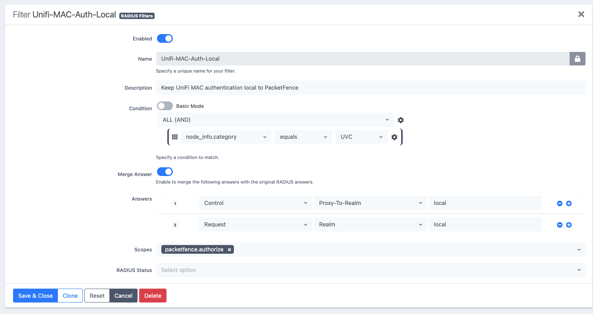

# MAC Authentication Bypass (MAB) on PacketFence

MAB is used for endpoints that cannot perform 802.1X. In the tested design the device class is `UVC` (UniFi cameras and security equipment).

> `UVC` is the actual tested category and role. Where this page needs a generic example it says so explicitly.

## Design (Tested)

1. Register the endpoint in PacketFence.
2. Assign it the explicit category `UVC`.
3. Configure the UniFi switch port for MAC-based authentication ([UniFi Configuration](../unifi/configuration.md#mac-authentication-bypass-on-switch-ports)).
4. Keep that category local to PacketFence with the RADIUS filter below, so the request is never proxied to JumpCloud.

```text
MAC:      00:11:22:33:44:55
Status:   Registered
Category: UVC
```

```text
UVC -> VLAN 200
```

## Flow

```text
UVC / registered device
  |
  v
UniFi switch port configured MAC-Based
  |
  v
PacketFence
  |
  | node_info.category == "UVC"
  v
Unifi-MAC-Auth-Local RADIUS filter
  |
  +-- control:Proxy-To-Realm = local
  +-- request:Realm = local
  |
  v
PacketFence local policy
  |
  v
UVC role / assigned VLAN
```

## RADIUS authorize filter (Tested)



```ini
[Unifi-MAC-Auth-Local]
scopes=packetfence.authorize
status=enabled
top_op=and
description=Keep UniFi MAC authentication local to PacketFence
merge_answer=yes
condition=node_info.category == "UVC"
answer.0=control:Proxy-To-Realm = local
answer.1=request:Realm = local
```

The effective filter file is:

```text
/usr/local/pf/conf/radius_filters.conf
```

**Both realm assignments are required.** Setting only `Proxy-To-Realm` was not sufficient in testing because the request could retain `Realm = null` and still follow the JumpCloud proxy path.

## Why node category (Rationale)

```text
node_info.category == "UVC"
```

makes local MAB an explicit trust decision recorded in PacketFence. Unknown devices are not trusted merely because they present a MAC-shaped username. This is a *handling* decision, not authentication: see the [MAB trust boundary](../security/security-model.md#mab-trust-boundary).

Do not alter the `NULL` realm globally to solve MAB. It is part of the known-good PEAP path.

## MAB approaches that failed or were rejected

| Approach | Outcome |
| --- | --- |
| `connection_type = Ethernet-NoEAP` as the sole early authorize-stage detector | Caught legitimate wired PEAP before the inner EAP/MSCHAPv2 exchange completed. Do not use. |
| MAC-shaped username matching, e.g. `radius_request.User-Name == "001122334455"` | Useful as a diagnostic proof; not scalable as policy. |
| `Service-Type` alone (`Call-Check`) | Helps identify MAB when debugging; the resolved node category proved a more reliable policy decision point. |

## Related

- [MAB Device Lifecycle](../operations/mab-device-lifecycle.md): registration, validation, replacement, retirement
- [Authentication Matrix](../architecture/authentication-matrix.md#unknown-and-unregistered-mac-behaviour): what happens to unregistered MACs (`needs validation`)
