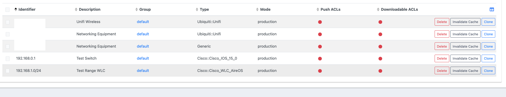
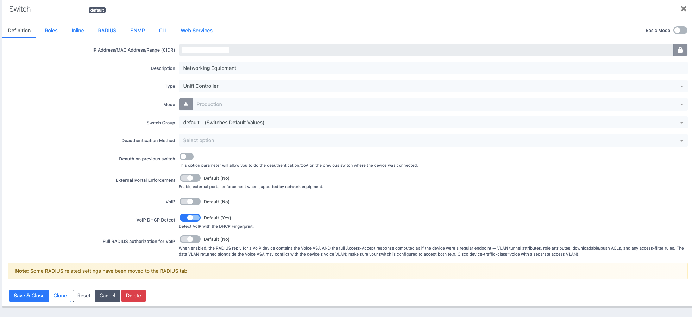
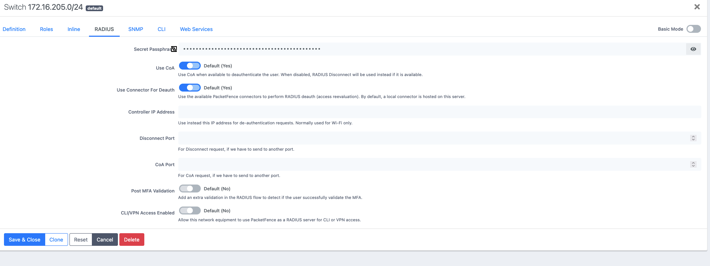
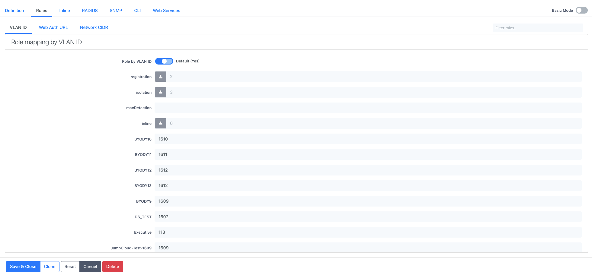

# PacketFence Network Device (NAS) Configuration

Every UniFi AP and switch that sends RADIUS to PacketFence is a RADIUS client (NAS). PacketFence must know the device or source range, with the matching shared secret, before it can process requests and map roles to VLANs.

## Where it lives

```text
Configuration
  -> Policies and Access Control
  -> Network Devices
       -> Switches
```

The tested deployment contains UniFi-specific network-device entries and supports both individual identifiers and CIDR ranges.



The UniFi entries use the UniFi-specific switch type and run in production mode.

## Tested UniFi network-device definition



The captured definition uses:

| Setting | Tested value |
| --- | --- |
| Type | `Unifi Controller` |
| Mode | `Production` |
| Switch Group | `default - (Switches Default Values)` |
| Deauthentication Method | Not explicitly selected |
| Deauth on previous switch | Disabled |
| External Portal Enforcement | Default (No) |
| VoIP | Default (No) |
| VoIP DHCP Detect | Default (Yes) |
| Full RADIUS authorization for VoIP | Default (No) |

The device/range identifier is intentionally redacted in the public screenshot.

## RADIUS settings



The tested RADIUS settings are:

| Setting | Tested value |
| --- | --- |
| Secret Passphrase | Configured and masked |
| Use CoA | Default (Yes) |
| Use Connector For Deauth | Default (Yes) |
| Controller IP Address | Blank |
| Disconnect Port | Blank |
| CoA Port | Blank |
| Post MFA Validation | Default (No) |
| CLI/VPN Access Enabled | Default (No) |

The shared secret must exactly match the secret configured in the UniFi RADIUS profile for both authentication and accounting.

Because `Use CoA` is enabled, this network-device definition is configured to use Change of Authorization when available. The actual behaviour of CoA/disconnect with the tested UniFi firmware still needs an explicit operational test before relying on it.

## Role-to-VLAN mapping



`Role by VLAN ID` is enabled on the tested UniFi network-device definition.

This is the point where a PacketFence role becomes the VLAN identifier returned to UniFi.

The screenshot shows tested mappings such as:

| Role | VLAN ID |
| --- | ---: |
| `BYODY9` | `1609` |
| `BYODY10` | `1610` |
| `BYODY11` | `1611` |
| `BYODY12` | `1612` |
| `BYODY13` | `1612` |
| `DS_TEST` | `1602` |
| `Executive` | `113` |
| `JumpCloud-Test-1609` | `1609` |

These are live/test-environment values shown in the screenshot. Use VLAN IDs appropriate to your own network.

Conceptually:

```text
JumpCloud group
    -> LDAP memberOf rule
    -> PacketFence role
    -> Network Device role/VLAN mapping
    -> Tunnel-Private-Group-Id
    -> UniFi applies VLAN
```

See the [Worked Example](../architecture/worked-example.md) for the full chain.

## What must match the UniFi RADIUS profile

| PacketFence network device | UniFi RADIUS profile | Status |
| --- | --- | --- |
| Device IP address or range | Source address of the AP/switch as seen by PacketFence | Tested |
| RADIUS shared secret | Authentication/accounting shared secret | Tested requirement |
| Authentication port | UDP/1812 | Tested |
| Accounting port | UDP/1813 | Tested |
| Role/VLAN mapping | RADIUS-assigned VLAN support enabled | Tested |

## Operational checks

- Confirm PacketFence receives RADIUS from the expected UniFi source address.
- Confirm the same shared secret is configured on both sides.
- Confirm the selected role has a VLAN mapping on the network-device definition.
- Confirm the VLAN exists across the switching path, DHCP, gateway and firewall.
- Treat CoA support as configured but not fully proven until a live reauthorization/disconnect test is completed.
- Keep secrets out of screenshots, repositories and tickets.

## Related

- [UniFi Configuration](../unifi/configuration.md)
- [Worked Example: Directory Group to VLAN](../architecture/worked-example.md)
- [Validation Checklist](../operations/validation-checklist.md)
- [Security Model](../security/security-model.md)
